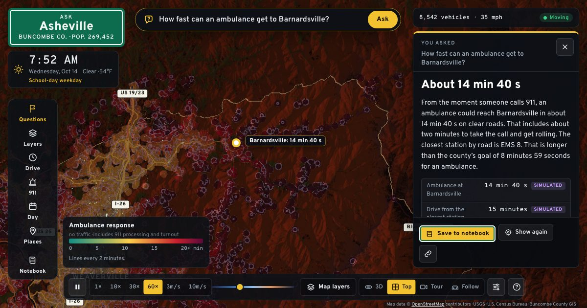

# Ask Asheville

A living 3D model of Asheville and Buncombe County, North Carolina, that students use to **ask
questions about their city and answer them with evidence they can check**.

**Open it:** https://michaellomuscio.github.io/ask-asheville/
&nbsp;·&nbsp; **Guide for teachers:** https://michaellomuscio.github.io/ask-asheville/teachers.html



Type a question in your own words:

> How long does it take to drive from Black Mountain to downtown?
> Where do the most kids live?
> How fast can an ambulance get to Barnardsville?
> Is income related to college degrees?
> What happens to traffic on a snow day?
> Where should a new fire station go?

The page works out the answer from Census counts, public records and a traffic simulation, shows the
evidence on the map, and says how it knows.

## Contents

- [What it does](#what-it-does)
- [How answers are made](#how-answers-are-made)
- [Privacy](#privacy)
- [What is real and what is modeled](#what-is-real-and-what-is-modeled)
- [Run it yourself](#run-it-yourself)
- [Tests](#tests)
- [Project layout](#project-layout)
- [Changing it](#changing-it)
- [Data sources](#data-sources)
- [Known limits](#known-limits)
- [Browser support](#browser-support)
- [Security](#security)
- [License and credits](#license-and-credits)

## What it does

| | |
|---|---|
| **Ask bar** | Takes a question or the name of a place, school, road or address. Suggestions appear as you type. A question the data can't answer gets a plain "this map doesn't have that" and questions it can answer instead. |
| **Answer cards** | A headline, one or two sentences, the numbers behind it, a chart where it helps, and a note on what the map now shows. Every number is labeled **Counted**, **Surveyed**, **Simulated** or **Measured**. "How do we know?" lists sources, what to keep in mind, and the vocabulary. "Ask next" offers follow-ups. |
| **The map** | Every road and all 184,954 buildings in the county on real terrain, with traffic that moves through a whole day. Answers draw on it: colored neighborhoods, numbered pins, routes, drive-time and response-time maps, town outlines. |
| **Guided investigations** | Twelve questions taken through predict, explore, explain and extend: emergency response, rush hour, kids and schools, reaching an emergency room, big events, comparing towns, correlation, mountains, siting a fire station, visitors, how data is made, and "my corner of the county". |
| **Notebook** | Any answer saves as an evidence card with a picture of the map. Students add notes, pick their evidence and write a Claim, Evidence, Reasoning piece, then print it, save a PDF or download it. |
| **Tools** | 33 map layers in plain language, drive-time maps, 911 calls answered through traffic, hypothetical stations, 13 kinds of day (school day, snow day, ballgame, leaf season...), weather, and a driver's-seat view. |
| **Links** | `#q=<question>` opens with that question answered; `#i=<id>` opens an investigation. Useful for posting to a class. |

## How answers are made

There is no AI service and no server. The question engine is ordinary JavaScript that runs in the
browser on data already loaded:

1. **Read.** `ask.js` looks for what it knows in the question: places (towns, neighborhoods, schools,
   landmarks, roads, addresses, with nicknames such as "downtown" or "the mall"), measures ("kids",
   "rent", "long commutes"), a direction ("most", "oldest"), a time of day, a kind of day, an
   emergency service, a kind of place.
2. **Route.** It picks one of about thirty kinds of answer: a drive time, who lives within N minutes, the
   nearest school or hospital, a ranking of neighborhoods or towns, a value for one place, a
   comparison, a correlation between two measures, traffic now or through the day, a what-if day,
   emergency response, the best site for a new station, elevation, school zones, county totals,
   a glossary word.
3. **Compute.** `core.js` does the arithmetic: sums of Census blocks, official values for towns,
   shortest paths over the road network, response times from stations, and so on.
4. **Show.** The answer carries a function that puts the evidence on the map, and the view is framed
   in the space the panels leave open.

When it cannot tell what is being asked it says so. When the question is about something the data
does not include (crime, bus routes, restaurants, elections, weather records) it says that instead of
guessing.

## Privacy

- No accounts, no analytics, no cookies, no server-side code.
- The page loads only from its own address. Three.js and the fonts are served with the site, so no
  other host is contacted. A content security policy in the page enforces this.
- Questions, the notebook, investigation notes and "my spot" are kept in the browser's local storage
  on that device and nowhere else. Clearing site data or switching devices loses them, which is why
  the notebook prints and downloads.
- The map reports people for Census areas (blocks, block groups, towns), never for a single home.
  Income and similar measures are shown for areas on the map, not next to an individual building.

## What is real and what is modeled

| Label | Meaning | Examples |
|---|---|---|
| **Counted** | An actual count | 2020 Census population and homes by block; jobs by block; schools and enrollment |
| **Surveyed** | An estimate from a sample, with a margin of error | American Community Survey 2020-2024: age, income, housing, schooling, commuting |
| **Simulated** | Calculated by this model | Drive times, traffic, 911 response times, who lives within N minutes |
| **Measured** | Measured directly | Elevation, distance, NCDOT traffic counts |

Every road, building and hill is real (OpenStreetMap on USGS terrain). Residents are placed in homes
so that every 2020 Census block adds up to its true count, and jobs and commutes follow Census work
data. About 780,000 simulated vehicle trips on a school day follow those commutes, school runs,
errands, deliveries and visitors. Drive times with no traffic are calibrated against openrouteservice
(77% of 8,082 test trips within 10%).

## Run it yourself

Requires Node 20 or newer. There is nothing to install and no build step.

```sh
git clone https://github.com/michaellomuscio/ask-asheville.git
cd ask-asheville
npm start            # serves docs/ at http://localhost:5180 (this computer only)
```

Any static file server pointed at `docs/` works too. Useful address options:

| Address | Effect |
|---|---|
| `?nosim` | The map and questions without moving traffic, for slow machines |
| `?hour=17.5` | Start the clock at 5:30 p.m. |
| `?scenario=snow` | Start on a different kind of day (ids are in `docs/src/sim/scenarios.js`) |
| `#q=Where do the most kids live?` | Open with a question answered |
| `#i=help-arrives` | Open a guided investigation |

## Tests

```sh
npm test                  # 26 unit tests of the simulation (Node, no browser)
npm start                 # in one terminal...
npm run test:questions    # ...then this: asks about 500 questions in headless Chrome
```

`test:questions` drives the real page (it expects Google Chrome on macOS; change the path at the top
of `tools/drive.mjs` for another system). It asks every example in `QUESTION_BANK`, every follow-up
those answers suggest (three levels deep), a "where is the most / the fewest" and a "which town"
question for every map measure, and every question the investigations send. Any question the engine
fails to answer fails the run. Run it before publishing a change to the question engine, the
investigations or the place list.

`tools/drive.mjs` is also handy for screenshots: give it a URL, an output folder and a small steps
file (see `tools/steps/questions.mjs` for the shape).

## Project layout

```
docs/                       the published site (GitHub Pages serves this folder)
  index.html                page shell
  teachers.html             guide for teachers (renders the investigation list from the same source)
  src/main.js               loads data, builds the scene, runs the frame loop
  src/lab/                  questions, answers, investigations, notebook
    ask.js                  reads a question and builds the answer; QUESTION_BANK
    core.js                 the calculations (area facts, rankings, drive times, reach, response...)
    gazetteer.js            every place a question can name; words for where a point is
    catalog.js              map measures in plain language, evidence labels, glossary
    ui.js                   ask bar, answer card, pins, map actions, Questions and Layers panels
    charts.js               small SVG charts
    investigations.js       the twelve investigations and their stepper
    notebook.js             evidence cards, write-up, print and download
  src/sim/                  road graph, routing, traffic, demand, scenarios, emergency, clock, weather
  src/render/               Three.js scene: terrain, roads, buildings, vehicles, overlays, camera
  src/data/                 binary bundle reader and data loader
  src/ui/                   HUD panels, inspector, legend, base styles
  data/                     built data (about 22 MB)
  vendor/                   three.js 0.186.1 and the Overpass fonts
pipeline/                   Python scripts that build docs/data from public sources
tests/                      node --test suites for the simulation
scripts/serve.js            development server
scripts/headless.js         runs whole simulated days in Node (produces the typical-day files)
tools/drive.mjs             headless-Chrome driver; tools/steps/questions.mjs is the question check
ARCHITECTURE.md             module contracts, coordinates, drive-time semantics
```

## Changing it

**A new nickname or neighborhood.** Add it to `ALIASES` in `docs/src/lab/gazetteer.js` (a point of
interest id, a name in `pois.json`, or a point in meters east and south of Pack Square).

**A new phrase for a measure.** Add a regular expression to that measure's `syn` list in
`docs/src/lab/catalog.js`. Add a question that uses it to `QUESTION_BANK` so the check covers it.

**A new kind of question.** Write an answerer in `docs/src/lab/ask.js` that returns an answer object
(`headline`, `sub`, `figures` with a badge on each, `sources`, `caveat`, `map`, `follow`, `show()`),
add a rule for it in `route()`, and add examples to `QUESTION_BANK`. Compute numbers from the data;
do not type them in.

**A new investigation.** Add an entry to `INVESTIGATIONS` in `docs/src/lab/investigations.js`. Each
step's `ask` must be a question the engine answers; the check will tell you if one is not.

**Rebuilding the data.** See `pipeline/README.md`. You do not need the pipeline to change the site.

**Publishing.** GitHub Pages is set to the `main` branch, `/docs` folder; pushing to `main`
publishes.

## Data sources

| Layer | Source |
|---|---|
| Roads, buildings, water, rail, places | OpenStreetMap (Geofabrik North Carolina extract, 2026-10-05), © OpenStreetMap contributors, ODbL |
| People and homes | 2020 Census, by block |
| Neighborhood, town, county, state and national measures | American Community Survey 2020-2024 5-year |
| Which town each block is in | 2020 Census Block Assignment Files |
| Jobs and commutes | Census LEHD LODES 8 (2023) |
| Schools | NCES Common Core of Data and Private School Survey; county attendance districts |
| Addresses, building land use, school zones | Buncombe County open GIS (land-use class codes only; no owner or value fields) |
| Terrain and land cover | USGS 3DEP (via AWS Terrain Tiles), NLCD 2021 |
| Traffic counts | NCDOT |
| Stations, hospitals, venues, visitor estimates | Agency pages and news reports, each with its source in `pipeline/research/buncombe_facts.json` |
| Free-flow drive times | Calibrated to openrouteservice 9.10 run locally on the same road data |

Terms for each are in [`docs/DATA-LICENSE.md`](docs/DATA-LICENSE.md).

## Known limits

- **Survey estimates for small areas are shaky.** Block-group and small-town values have wide
  margins of error; close results should be read as ties. The answers say so.
- **The traffic is a model of a typical day**, not live traffic. Event and visitor volumes are
  estimates.
- **Response times assume a crew is in the station and ready.** Ambulance base locations are mostly
  approximate. Police times are measured from buildings, though officers usually respond from patrol.
- **Neighborhoods have no official edges.** Answers about a neighborhood use the Census areas around
  its map label and say so.
- **Building heights and names** come from OpenStreetMap volunteers and are incomplete.
- **Not in the data:** crime, bus routes, sidewalks and bike lanes, flooding and storm damage, parks,
  businesses, elections, weather records, school test scores, and race beyond two shares.
- **The question reader is a set of rules, not a language model.** It handles the phrasings in the
  check and many near them, and misses others.
- **Not yet tried on real devices:** it has been exercised in headless Chrome at laptop, large-screen
  and phone sizes, not on physical Chromebooks, phones, Safari or Firefox, and the notebook's print
  dialog has not been used for real.

## Browser support

A current Chrome, Edge, Firefox or Safari with WebGL 2. The first load fetches about 22 MB. On
machines with four or fewer processor cores or little memory it starts at reduced detail and with
fewer simulated vehicles; `?nosim` goes further. It lays out for phones, but a laptop or tablet is
the intended screen.

## Security

The site is static files with no backend, no login and no third-party requests. To report a
problem, see [`SECURITY.md`](SECURITY.md).

## License and credits

- Code: MIT (see [`LICENSE`](LICENSE)).
- Data: built from OpenStreetMap and public sources. The OpenStreetMap-derived files are under the
  Open Database License; credit © OpenStreetMap contributors. See
  [`docs/DATA-LICENSE.md`](docs/DATA-LICENSE.md).
- [three.js](https://threejs.org/) (MIT) and the [Overpass](https://overpassfont.org/) typefaces
  (SIL Open Font License 1.1) are served from `docs/vendor/` with their licenses.
